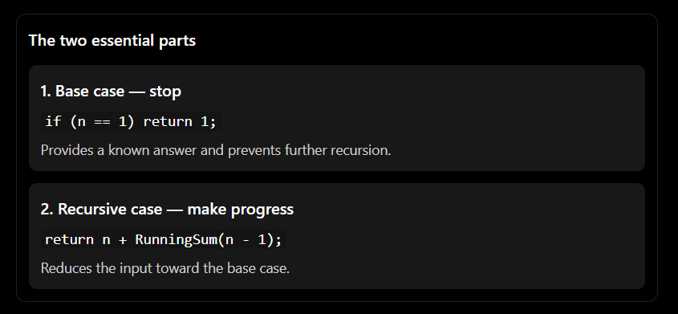
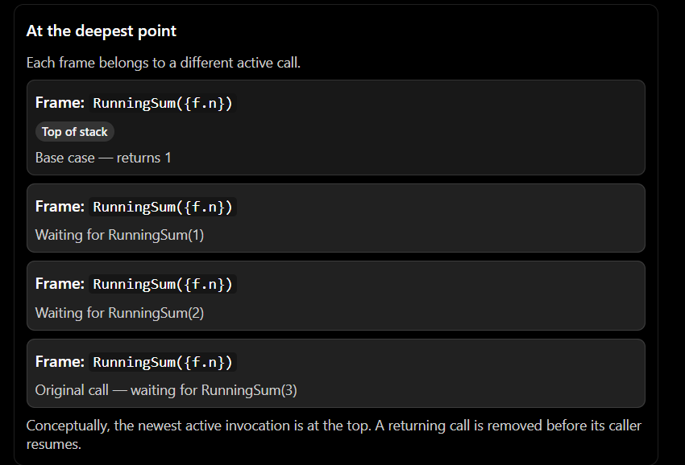
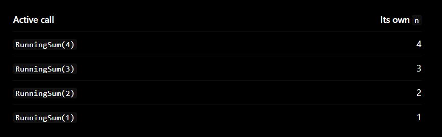
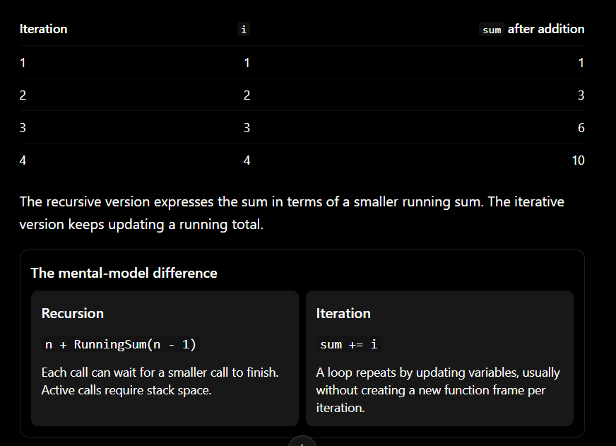
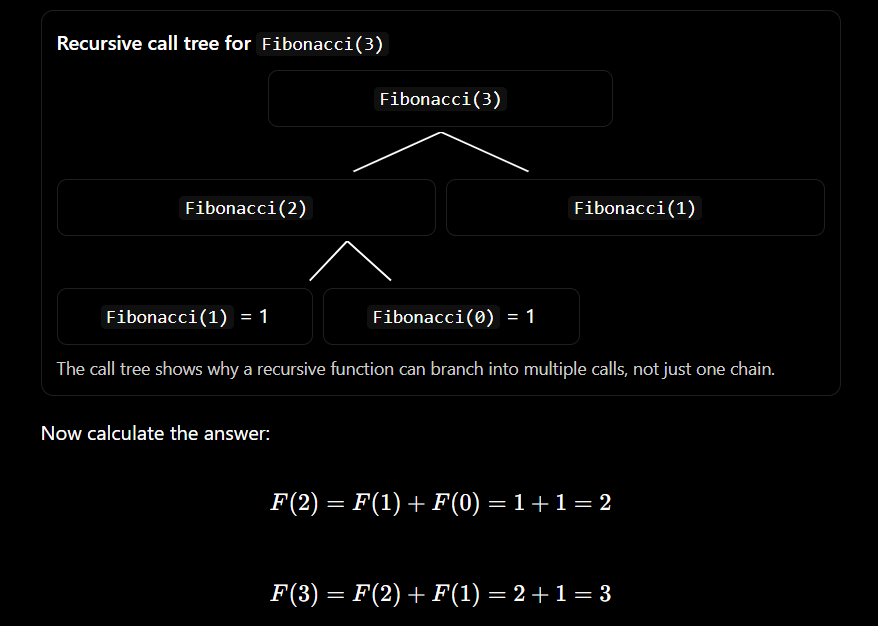

## First recursive C function
```
int RunningSum(int n)
{
    if(n == 1)
        return 1;

    return n + RunningSum(n - 1);
}
```

read it slowly, line by line.

#### Line 1:
```
int RunningSum(int n)
```

We define a function that receives an interger called n and returns an interger.

#### Line 3-4:
```
if(n == 1)
   return 1;
```

if n is 1, we already know the answer. Return 1 immediately

this is the base case: a condition under which the function can finish without making another recursive call.

#### Line 6:
```
return n + RunningSum(n - 1);
```

if n is not 1, we add n to the result of  calling RunningSum with n - 1.

This is the recursive case: the part that produces the problem and calls the same function again.



One important limitation: this simple version assumes n >= 1. if you pass zero or a negative number, the calls will not reach n == 1; that can eventually exhaust the call stack.


### Trace the calls: RunningSum(4)
This is where recursion often becomes confusing. The key is to distinguish going deeper into calls from returning their results.

Suppose we execute:
```
int answer = RunningSum(4);
```

The function starts evaluating:
```
RunningSum(4)
```

it is not equal to 4 alone. it needs the result of RunningSum(3) first.

So it becomes:

    RunningSum(4) = 4 + RunningSum(3)

But we don't know RunningSum(3) yet. We expand that call:

    = 4 + (3 + RunningSum(2))

expand again:

    = 4 + (3 + (2 + RunningSum(1)))

Now we reach the base case:

    RunningSum(1) = 1

Substitute the known answer:

    = 4 + (3 + (2 + 1)) = 10

#### The most important insight
When RunningSum(4) calls RunningSum(3), the first call does not disappear. it pauses while waiting for  the result.

Likewise, RunningSum(3) pauses while RunningSum(2) runs.

Eventually, the deepest call returns a value. That value allows the previous call to finish, which allows the next one to finish, and so on.

there are therefore two directions to understand:
- Call direction: 4 -> 3 -> 2 -> 1
- Return direction: 1 -> 3 -> 6 -> 10

The calls move toward a simple case; the answer travel back toward the original caller.


### What happens in memory? The runtime stack
you already learned about stack frames when studying C memory. Recursion puts that knowledge to work

Recall the earlier mental model:
- A function call creates an active invocation.
- its parameters and local variables belong to that invocation.
- the invocation must preserve its state while another function runs
- when it returns, its invocation finishes and its stack frame can be removed.

A recursive call follows the same rules as any other function call. the runtime stack naturally supports recursion; the computer does not need special kind of memory just for recursive functions.

For RunningSum(4), imagine the stack as follows. The diagram is conceptual, not a promise about exact machine address or stack layout.



Why does each invocation need its own frame?

Imagine that every invocation shared a single variable n. When the call for 4 changed the working value to 3, it could overwrite the value needed by the earlier call. Then the call for 3 could overwrite it again.

Instead, each active call has its own parameter value:



When RunningSum(1) returns, its frame finishes. The invocation for 2 resumes with  its own n = 2, computes 2 + 1, and returns 3.

Connect this to LC-3: when you studied subroutines and recursion in assembly, you encountered the need to preserve return information and values across calls. In C, the compiler and runtime implement the corresponding calling conventions and stack-frame management. The language-level function is easier to read, but the underlying need to preserve each active call's state remains.


### Recursion versus iteration: two ways to repeat work
You already know loops such as for and while. Recursion and iteration both express repeated computation, but they organize it differently. The book notes that recursion can express some problems more elegantly, while often adding execution overhead compared with iteration.

Let's calculate the same running sum using a loop:
```
int RunningSumLoop(int n)
{
    int sum = 0;

    for(int i = 1; i <= n; i++){
        sum += i;
    }

    return sum;
}
```

For n = 4, the loop does this:



Neither approach is automatically better in every situation.

- Use a loop when it expresses the task clearly and efficiently.
- Consider recursion when the problem naturally breaks into smaller version of itself, especially when exploring trees, nested structures, or alterantive paths.
- Always consider the call-stack cost and whether repeated work makes the recursive approach inefficient.


### The Fibonacci example: elegant definition, expensive computation 

    F(n) = F(n - 1) + F(n - 2)

with F(0) = 1 and F(1) = 1.

Here is the C function:
```
int Fibonacci(int n)
{
    if (n == 0 || n == 1)
        return 1;

    return Fibonacci(n - 1) + Fibonacci(n - 2);
}
```

Notice the difference from RunningSum:
- RunningSum makes one recursive call at each level.
- Fibonacci can make two recursive calls at each non-base-case level.

For example, Fibonacci(3) requires Fibonacci(2) and Fibonacci(1). But Fibonacci(2) itself requires Fibonacci(1) and Fibonacci(0).



This code is easy to relate to the mathematical definition. But it repeats work: Fibonacci(1) is evaluated more than once, and larger inputs cause many overlapping calculations.

That is why the book presents recursive Fibonacci as a useful illustration of recursion and stack behavior, but a poor choice when efficiency matters. 
96a2b94d4be48285f2605d843a1e6db37da9a944(2).pdf

The lesson: a recursive solution can be easy to understand and still be computationally inefficient. Correctness and efficiency are separate questions.


### Recursion needs more than a base case: it needs progress
This function is dangerous:
```
int RunningSum(int n)
{
    if (n == 1)
        return 1;

    return n + RunningSum(n - 1);
}
```
It works for positive inputs starting at 1. But if n is zero, it calls RunningSum(-1), then RunningSum(-2), and so on.

It never reaches n == 1.

A safer version rejects inputs outside its defined domain:
```
int RunningSum(int n)
{
    if (n < 1)
        return 0;  // Chosen behavior for invalid/non-positive input

    if (n == 1)
        return 1;

    return n + RunningSum(n - 1);
}
```

Here, returning zero for non-positive input is a design decision, not a universal rule. In a real program, you should decide what invalid input means for your function and document that behavior.

A useful way to check any  recursive function is to ask three questions:
1. Base case: What input can be answered immediately?
2. Progress: Does each recursive call moves toward that case?
3. Combination: How does the function use the returned result to produce the current answer?

if you cannot answer all three, the recursive definition may be incomplete or incorrect.

### A more complex application: escaping a maze
The book applies recursion to a maze represented as a two-dimensional character array. Each cell can represent a wall ('X'), an open space (' '), or the exit ('E'). The function receives the maze and the current coordinates, then searches neighboring cells.

The core idea is:

    If the exit can be reached from the current position, try moving to a neighboring position and solve the same maze problem from there.

The function can explore down, right, up, and left. But this introduces a new danger: a path could lead back to a cell the algorithm has already visited.

To prevent endless cycles, the book marks visited spaces with 'V'. When the algorithm finds a successful path, it marks the path with 'P'. It also stops when it hits a wall, leaves the maze boundaries, or finds the exit. 

Here is the book's essential function, with the control flow preserved:
```
#define MAZE_HEIGHT 4
#define MAZE_WIDTH 4

int ExitMaze(char maze[MAZE_HEIGHT][MAZE_WIDTH],
             int xpos, int ypos)
{
    if (xpos < 0 || xpos >= MAZE_HEIGHT ||
        ypos < 0 || ypos >= MAZE_WIDTH)
        return 0;

    if (maze[xpos][ypos] == 'E')
        return 1;

    if (maze[xpos][ypos] != ' ')
        return 0;

    maze[xpos][ypos] = 'V';

    if (ExitMaze(maze, xpos + 1, ypos)) {
        maze[xpos][ypos] = 'P';
        return 1;
    }

    if (ExitMaze(maze, xpos, ypos + 1)) {
        maze[xpos][ypos] = 'P';
        return 1;
    }

    if (ExitMaze(maze, xpos - 1, ypos)) {
        maze[xpos][ypos] = 'P';
        return 1;
    }

    if (ExitMaze(maze, xpos, ypos - 1)) {
        maze[xpos][ypos] = 'P';
        return 1;
    }

    return 0;
}
```

This example combines several concepts you already know:

- Arrays: the maze is a 2D array, addressed using maze[xpos][ypos].
- Function arguments: each call receives a position.
- Recursion: the function calls itself for neighboring positions.
- Mutable state: visited cells are marked in the same maze array.
- Base cases: boundaries, walls, visited cells, and the exit stop further exploration from that position.
- Return values: 1 means a path was found; 0 means the attempted route failed.

The search is a form of depth-first search: it follows one possible path as far as it can, then backs up and tries another when a route fails.

#### Why the P marking happens after a successful call
Consider this code:
```
if (ExitMaze(maze, xpos + 1, ypos)) {
    maze[xpos][ypos] = 'P';
    return 1;
}
```

The current cell tries the cell below it.

- If that recursive call returns 0, the route below did not find the exit, so this branch continues to the next direction.
- If it returns 1, the route below has found a way to the exit.
- The current cell then marks itself 'P' and returns 1 to its caller.


As the successful result returns up through the active calls, each cell on that route is marked as part of the path.

That is an important and powerful pattern: the work done while calls go deeper explores possibilities; the work done after a successful return can reconstruct the solution.


### The hidden cost: stack space and repeated work
Each recursive call needs its own active invocation state. That consumes runtime resources, typically including space on the call stack.

If recursion gets too deep, the program can exhaust its available stack. The exact limit depends on the environment; C does not guarantee a particular safe recursion depth.

There are two common costs to watch:
- Depth cost: a long chain of calls can consume substantial stack space.
- Repeated-work cost: a branching recursion, such as the simple Fibonacci implementation, may recompute the same subproblems many times.

A loop can be more suitable when the problem is a simple sequence of updates. Recursion can be a natural fit when the problem itself branches or contains nested structure, as with maze exploration.