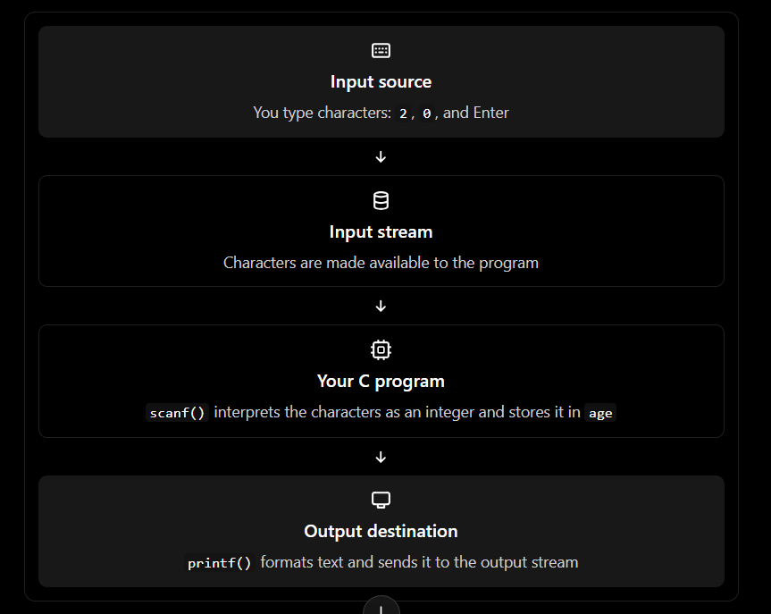
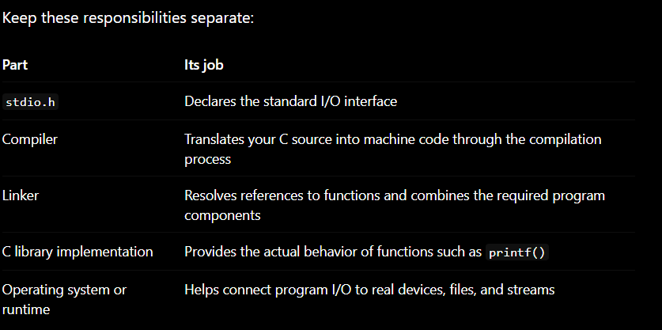
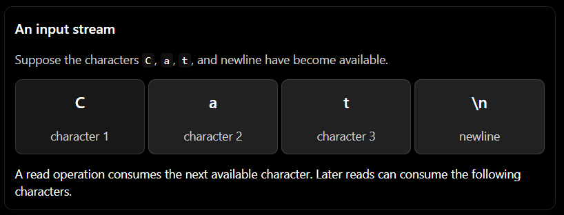
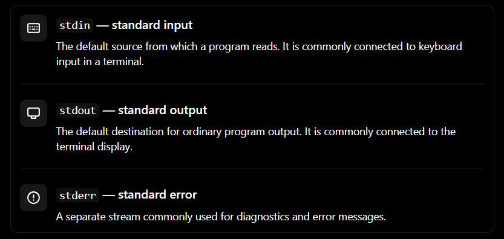
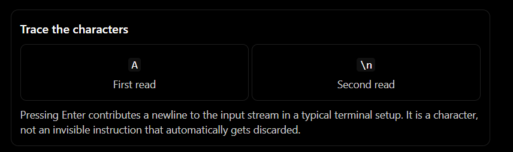
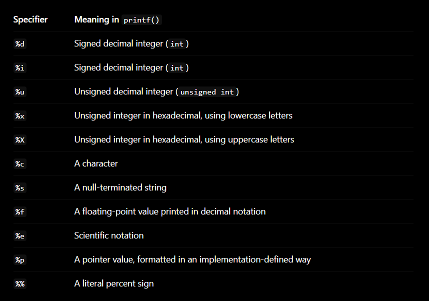
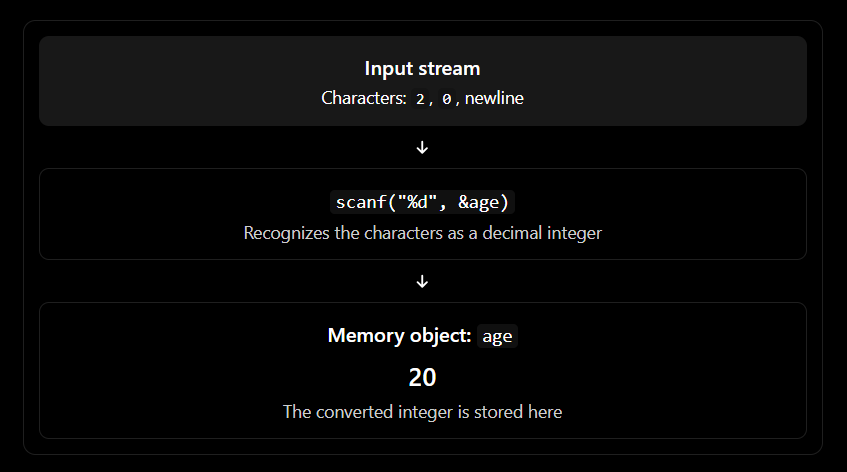

## Start with the central question: how does a program communicate?
imagine this C program:
```
include <stdio.h>

int main(void)
{
    int age;

    printf("Enter your age: ");
    scanf("%d", &age);

    printf("Your age is %d\n", age);

    return 0;
}
```

You type 20, press Enter, and see the result. But let's look at what the program actually needs to do.



the crucial idea is that your program does not magically receive an integer just because you typed digits.

you type characters. The input mechanism makes those characters available. scanf() interprets them according to the format string, converts them to a value, and stores that value in memory.

Similarly, printf() does not simply display a variable's memory. it interprets a format string, converts values into a textual representation, and sends that text to an output stream.

This is the  foundation of I/O in C.


### The C standard library: Where I/O functions come from
Before we examine the four main functions, connect this chapter to what you learned about compilation and linking.

Consider:
```
#include <stdio.h>

int main(void)
{
    putchar('A');
    return 0;
}
```

you wrote putchar('A'), but you did not write the implementation of putchar() yourself. Where does that function come from?

it comes from the C standard library, which supplies reusable functions for common tasks such as input/output, string manipulation, mathematics, and file access.

#### What does #include <stdio.h> actually do?
you already learned that a header file provides declaration and related information needed by the compiler.

for this chapter, stdio.h declares standard I/O facilities, including functions such as:

- putchar() - output one character.
- getchar() - input one character.
- printf() - formatted output.
- scanf() - formatted input.
- fprintf() and fscanf() - formatted I/O using a specified stream, commonly a file.

The header generally does not contain the complete machine-code implementation of these library functions. The linker and runtime environment make the necessary implementation available to your program. depending on the platform and toolchain, that may involve static or dynamic linking.



Mental model: a header tells your source code how to call a function; it is not, by itself, the functions complete implementation.

This is the same distinction you learned earlier between declaring something and providing its implementation.


### I/O streams: think of data as a flow
the book's central abstraction is the stream. Rather than forcing a program to communicate directly with the physical keyboard or display every time, the I/O system presents a sequence of data that can be read or written.

imagine  a stream as a queue of characters:



The producer put data into a stream; the consumer reads it. The two sides can work at different rates, which is one reason the abstraction is useful.

for example, a user may type several characters faster than you program processes them likewise, your program may generate output faster than a display can show it.

#### The three standard streams
C provides three familiar standard streams



the book focuses primaarily on stdin and stdout, then extends the same stream idea to files. stderr is also part of standard C and is useful to know in practical programs.

Here is a small example:
```
#include <stdio.h>

int main(void)
{
    printf("Normal output\n);
    fprintf(stderr, "Diagnostic message\n");

    return 0;
}
```

printf() writes to stdout. fprintf(stderr, ...) writes to stderr.

the terminal may display both messages together, but they are logically separate streams. this becomes useful when output is redirected to a file while errors remain visible in the terminal.

### Character I/O: putchar() and getchar()

#### 4.1 putchar() - output one character
```
putchar('A');
```
This sends the character A to standard output.

Compara these cells:
```
putchar('A');
putchar(65);
putchar('B');
```

on an ASCII-compatible system, the first two calls output the same character because the ASCII code for A is 65. the third outputs B.

The important distinction is that putchar() does not  format an integer as a decimal number. it treats its argument as a character value and writes that character to the output stream.

compare:
```
printf("%d\n", 65);
putchar(65);
```

The first outputs the two characters 6 and 5, followed by a newline. The second outputs the single character A on an ASCII-compatible system.

Why? Because the two functions have different jobs:

- printf(%d", 65) converts the number 65 into the textual representation "65".
- putchar(65) writes the character represented by character code 65.

this is the difference between formatting a numeric value and outputting a character.

#### 4.2 getchar() - read one character
```
int ch = getchar();
```

getchar() reads the next character from stdin and returns its value. it returns an int, not a char, because it must also be able to represent the special value EOF(end-of-file or input failure indication).

For a beginner, the important lesson is to store its result in an int when you need to detect EOF reliably.
```
#include <stdio.h>

int main(void)
{
    int ch;

    ch = getchar();

    if(ch != EOF){
        putchar(ch);
        putchar('\n');
    }

    return  0;
}
```

The program reads one charater and writes it back, provided the read did not return EOF.

Connect to LC-3: the book relates getchar() and putchar() to the LC-3 IN and OUT trap routines. In both cases, the program uses a higher-level interface to read or output character data; the C library hides the lower-level mechanics


#### 4.3 why does getchar() sometimes appear to wait for Enter?
try this program:
```
#include <stdio.h>

int main(void)
{
    int first;
    int second;

    printf("Input character 1:\n");
    first = getchar();

    printf("Input character 2:\n");
    second = getchar();

    printf("First: %c\n", first);
    printf("Second: %c\n", second);

    return 0;
}
```

Suppose you type A and press Enter.

on a typical terminal with line-buffered keyboard input, the input stream can receive both the A and the newline character. The first getchar() reads A; the second can read the newline left behind by pressing Enter.

So the second call may not wait for another keypress at all.



This behavior is related to buffering.

The terminal or runtime commonly collects typed characters in an input buffer until a line is submitted. This lets a user correct a typo before the program consumes the line. Once the input is made available, character-reading functions consume characters from that stream in order.

A useful mental model is:

1. You type characters.
2. The terminal/input layer collects them.
3. Pressing Enter commonly makes the line available to the program.
4. each getchar() reads the next available character.
5. The newline may remain for the next read.

Do not assume that every environment uses exactly the same buffering behavior. Interactive terminals, redirected input, IDE consoles, and other environments can behave differently. The key idea is that the function reads from a stream; it does not necessarily communicate with a physical keypress directly.


#### 4.4 Output buffering: why output might appear later
Output can also be buffered. A program can write characters to an output stream, and the runtime may collect them before sending them to the destination. the timing depends on the stream and environment. The book illustrates this with output that appears only after a newline flushes the buffer.

For example:
```
printf("Working ...");
```
The absence of a newline means you should not assume that the text will immediately become visible in every environment.

if you need to request that buffered output be delivered, C provides:
```
fflush(stdout);
```

for example:
```
printf("working ...");
fflush(stdout);
```

This is especially useful for prompts that should appear before the program waits for input. Be careful: fflush(stdin) is not a portable way to discard keyboard input in standard C.

The distinction is between writing data to a stream and the data becoming visible at the final destination. Buffering helps the system operate efficiently, but it can make timing less obvious.


## Formatted output with printf()
Consider:
```
int age = 20;
printf("Age = %d\n", age);
```

The function receives two things:

1. The format string: "Age = %d\n"
2. The additional argument: age, whose value is 20

the %d tells printf() how to convert the corresponding argument into text. The \n represents a newline.

The output is:
```
Age = 20
```

the program stores age as an interger. The output stream, however, receives characters representing the number. That conversion is part of printf()'s job.


### 5.1 The format string is a set of instructions
Look at this example:
```
int age = 20;
float temperature = 26.5f;

printf("Age: %d, temperature: %.1f\n", age, temperature);
```

Read the format string from left to right:

- Age: is ordinary text.
- %d says to format the next argument as a decimal integer.
- , temperature: is ordinary text.
- %.1f says to format the next argument as a floating-point number with one digit after the decimal point.
- \n adds a newline.

the output is:
```
Age: 20, temperature: 26.5
```

The format string controls how the arguments are interpreted and displayed


### 5.2 Common conversion specifiers



The book also discusses converting integers into hexadecimal and character output, as well as outputting strings stored in consecutive memory locations.

A note about standards: the book mentions %b when discussing binary output, but %b is not a portable conversion specifier in C18, the C version identified by the book. Support depends on the C standard and compiler/library implementation. For code intended to work broadly with C18, do not assume that printf("%b", value) will print binary.


### 5.3 Formatting width and precision
Conversion specifiers can contain extra formatting instructions.

```
int number = 42;
double price = 7.5;

printf("%5d\n", number);
printf("%.2f\n", price);
printf("%8.2f\n", price);
```

Conceptually:

- %5d uses a minimum field width of five characters.
- %.2f prints two digits after the decimal point.
- %8.2f combines a minimum width of eight characters with two digits after the decimal point.

Typical output:
```
   42
7.50
    7.50
```

width does not automatically truncate a value that is too large for the field. It specifies a minimum width.


### 5.4 The dangerous mistake: the format and argument disagree
Consider:
```
float x = 192.27163f;

printf("%d\n", x);   // Incorrect
```

This is not a valid way to print a floating-point value. %d tells printf() to retrieve an int argument, but the expression x is passed as a floating-point argument. The format and argument types do not match, which causes undefined behavior.

The correct call is:
```
printf("%f\n", (double)x);
```

In a variadic function such as printf(), a float argument is promoted to double, so you could also write:
```
printf("%f\n", x);
```

The cast is not required here.

This connects to the memory and type model you learned earlier: the same sequence of bits cannot safely be interpreted as any type we happen to request. The function call has to obey the type requirements associated with its format string.

Rule: every conversion specifier must match the type of the corresponding argument, subject to the standard's specified argument promotions.


## scanf(): formatted input is not the reverse of printing
it is tempting to think that scanf() simply reverses printf(). the two functions are related, but input introduces a separate problem: the characters in the stream may not represent the value your program expects.

Consider:
```
int age;

scanf("%d", &age);
```

The %d tells scanf() to read a sequence of characters representing a decimal integer convert that sequence into an integer value, and store it at the location supplied by &age.


### 6.1 Why does scanf() need &age?
You learned about pointers in Chapter 16.

Let's recall:
```
int age;
```
age is an integer object. Its value is not the same thing as its address.

When we write:
```
scanf("%d", &age);
```
we pass the address of age to scanf(). That gives the function a location where it can store the converted value.

If you instead wrote:

scanf("%d", age);  // Incorrect

you would pass the integer value of age where scanf() expects a pointer to an integer. This is a type mismatch and can cause undefined behavior.

The memory-level sequence is:



The & is not a special scanf() operator. It is the ordinary C address-of operator you already know. scanf() needs the address because its job includes writing into your variable.

One exception worth remembering: when you pass a character array as a %s destination, the array expression normally converts to a pointer to its first element, so you write scanf("%s", name), not scanf("%s", &name).

### 6.2 scanf() with multiple values

```
int day, month, year;

scanf("%d/%d/%d", &day, &month, &year);
```

if the input is:
```
12/10/2026
```

the conversion specifications read the three decimal numbers. The literal / characters in the format string tell scanf() to match slash characters in the input stream.

This is an important point: characters in a scanf() format string are not all conversion instructions. Some are literal characters that the input must match.

The book demonstrates this behavior with a format string containing %d/%d/%d and explains how the numbers are assigned to the locations provided as arguments.


### 6.3 Whitespace: why spaces and newlines can behave unexpectedly

Most whitespace in a scanf() format string—including spaces, tabs, and newlines—directs the function to skip any amount of input whitespace. Many conversions, including %d and %s, also skip leading whitespace automatically.

for example:
```
int x;
scanf("%d", &x);
```
if the stream begins with spaces followed by 123, the leading whitespace is skipped and x becomes 123.

But %c behaves differently:
```
char ch;
scanf("%c", &ch);
```
The %c conversion reads the next character, including whitespace. If a newline remains in the input stream, ch may become '\n'.

If you want to skip leading whitespace before reading a character, you can use a space before %c:
```
scanf(" %c", &ch);
```

The space in the format string tells scanf() to consume any amount of whitespace before attempting the character conversion.

Be precise about the difference: the whitespace directive skips whitespace, not arbitrary non-whitespace characters.

### 6.4 %s and the end of a string
The book explains that %s reads a sequence of non-whitespace characters and appends a null character ('\0') to terminate the resulting C string.

For example:
```
char name[20];

scanf("%19s", name);
```

if the input is:
```
Vikrant Kumar
```
then the first %s conversion reads Vikrant and stops at the space. Kumar remains in the input stream for a later read.

why use %19s instead of %s?

The array contains 20 bytes. A C string needs space for its characters and the terminating null character. Limiting the conversion to 19 input characters leaves room for '\0'.

Without a width limit, an excessively long input word can overflow the array and overwrite memory outside the object.

This is where Chapter 18 connects directly to Chapter 16: a C string is a character array with a null terminator, and a pointer does not tell scanf() how much memory is available. The programmer must provide an appropriate bound.


### 6.5 Always check what scanf() returns
This is one of the most important practical lessons in the chapter.
```
int age;

if (scanf("%d", &age) == 1) {
    printf("Age: %d\n", age);
} else {
    printf("The input was not a valid integer.\n");
}
```

scanf() returns the number of input items successfully matched and assigned. If the conversion fails before any assignment, it can return 0; if input ends before the first conversion can complete, it can return EOF. 


Suppose the input is:
```
twenty
```
scanf("%d", &age) cannot convert the initial characters to a decimal integer. It does not magically turn the word into the number 20.

Checking the return value lets the program detect that the expected input was not obtained.

A failed conversion can also leave the offending characters in the stream. If your program simply repeats the same scanf() without consuming or otherwise handling that input, it may fail repeatedly. Robust input handling must account for both the return value and what remains in the stream.


## The hidden mechanism behind printf() and scanf(): variable argument lists

You already know how ordinary functions receive arguments:
```
int add(int a, int b)
{
    return a + b;
}
```
This function expects two integer arguments. But consider:
```
printf("%d %d %d\n", x, y, z);
```
Now consider:
```
printf("%d\n", x);
```
And:
```
printf("%d %d %d %d %d\n", a, b, c, d, e);
```
The number of arguments after the format string varies.

How can one function accept a variable number of arguments?

### 7.1 Variadic functions
C supports functions with a variable number of arguments, called variadic functions. Their declarations use ... .

A simplified declaration for printf() looks like this:
```
int printf(const char *format, ...);
```
The first parameter is the format string. The ... indicates that additional arguments may follow.

You do not need to implement your own variadic function yet. The important thing is to understand how the idea works:

1. printf() receives the format string.
2. it examines that string.
3. it encounters a conversion specifier such as %d.
4. it obtains the corresponding argument and interprets it according to the required type.
5. it converts the value into output characters.
6. it continues until the format string has been processed.

the format string tells the function how to interpret the additional arguments.

There is an important limitation: a variadic function cannot automatically determine the types of its additional arguments from the arguments alone. With printf(), the format string supplies that information. If the format string and the actual arguments disagree, the behavior can be undefined.


### 7.2 Connect this to the runtime stack and LC-3
In your earlier chapters, you learned that a function call involves passing arguments and preserving information needed to return to the caller.

The book uses printf() and scanf() to demonstrate how variable argument lists relate to the LC-3 runtime stack. Its discussion explains why the order in which arguments are placed on the stack can make it easier for a function to locate the format string regardless of how many additional arguments follow. 


The underlying concept is the same one you have already learned:

- A function needs access to its arguments.
- A function needs to know how to interpret those arguments.
- A calling convention determines how arguments are passed.
- The function uses the supplied information to carry out its work.

This is a useful bridge between high-level C and the machine-level mechanics you studied earlier. C hides many calling details, but the compiler and runtime still have to implement them.


## File I/O: streams are not limited to the keyboard and display
So far, our examples have used the terminal. But imagine writing a program that analyzes a large text file.

You could ask the user to type thousands of lines manually, but that would be impractical. A more useful approach is to read the data from a file and write the results to another file.

The book's key observation is that standard I/O treats streams as the common abstraction, whether they are connected to a keyboard, a display, or a file.

### 8.1 printf() versus fprintf()
You already know:
```
printf("Total: %d\n", total);
```
This writes formatted output to stdout.

The more general function is fprintf():
```
fprintf(file_pointer, "Total: %d\n", total);
```
It takes a stream argument, followed by the format string and any additional values.

Likewise:

- scanf() reads formatted input from stdin.
- fscanf() reads formatted input from a specified stream.

That is the main conceptual difference: fprintf() and fscanf() let you specify the stream instead of always using the standard input or output stream.

### 8.2 OPening a file with fopen()
In C, fopen() associates a stream with a file

Here is  a small example that writes a line to a text file:
```
#include <stdio.h>

int main(void)
{
    FILE *file = fopen("output.txt", "w");

    if (file == NULL) {
        fprintf(stderr, "Could not open the file.\n");
        return 1;
    }

    fprintf(file, "Hello from C!\n");

    if (fclose(file) == EOF) {
        fprintf(stderr, "An error occurred while closing the file.\n");
        return 1;
    }

    return 0;
}
```

Let's understand the important pieces.

FILE *file

FILE is a type provided by the standard I/O library. The pointer represents a stream managed by the library. It is not simply a pointer to the file's raw bytes in memory.

fopen("output.txt", "w")

This asks the library to open a file for writing. The mode "w" creates a new file or truncates an existing file of that name, if opening succeeds.

file == NULL

Opening can fail. For example, the program may lack permission, or the destination path may be invalid. The program must not use the returned stream pointer as though opening had succeeded.

fprintf(file, ...)

The output goes to the file stream rather than the terminal's standard output stream.

fclose(file)

The program closes the stream when finished. Closing also allows buffered output to be finalized, and it can report an error. In real programs, check important I/O results rather than assuming every operation succeeds.

The book introduces fopen() as the way to bind a file pointer to a physical file and fprintf()/fscanf() as the more general formatted I/O operations. 

### 8.3 Reading formatted values from a file
Suppose a file named input.txt contains:
```
42 3.14
```

you can read the two values like this:
```
#include <stdio.h>

int main(void)
{
    int count;
    double measurement;

    FILE *file = fopen("input.txt", "r");

    if (file == NULL) {
        fprintf(stderr, "Could not open input.txt\n");
        return 1;
    }

    if (fscanf(file, "%d %lf", &count, &measurement) == 2) {
        printf("Count: %d\n", count);
        printf("Measurement: %.2f\n", measurement);
    } else {
        fprintf(stderr, "Input did not match the expected format.\n");
        fclose(file);
        return 1;
    }

    fclose(file);
    return 0;
}
```

Notice that fscanf() uses %lf for a double * destination. In scanf()-family functions, %f expects a float *, while %lf expects a double *.

That is different from printf(), where a float argument is promoted to double, and %f is used to print a floating-point value.

This difference is a classic source of bugs, so keep the two families separate in your mind.