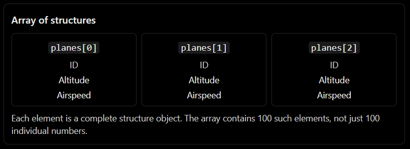
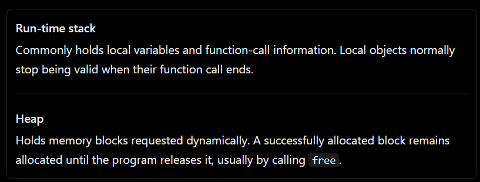
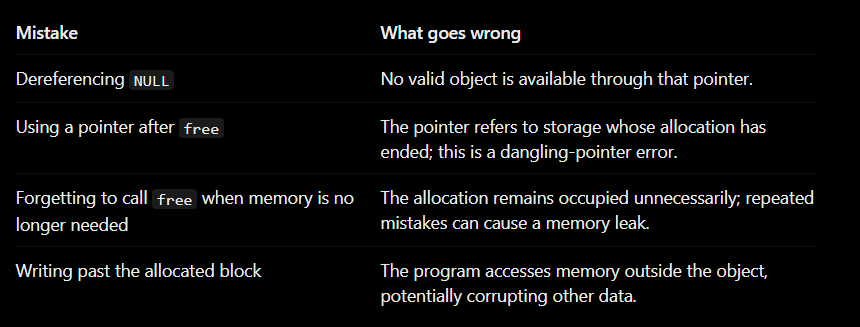
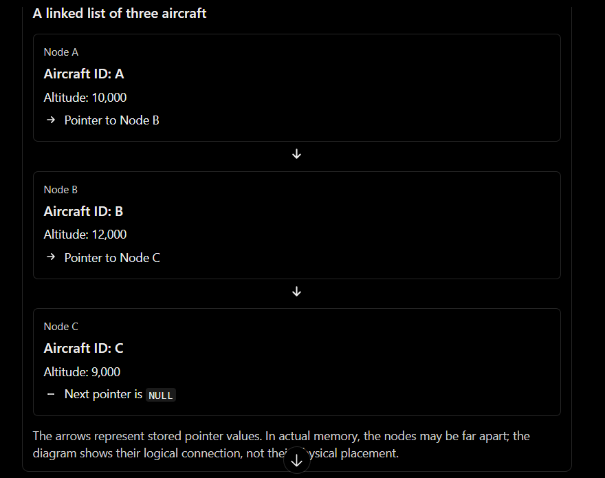
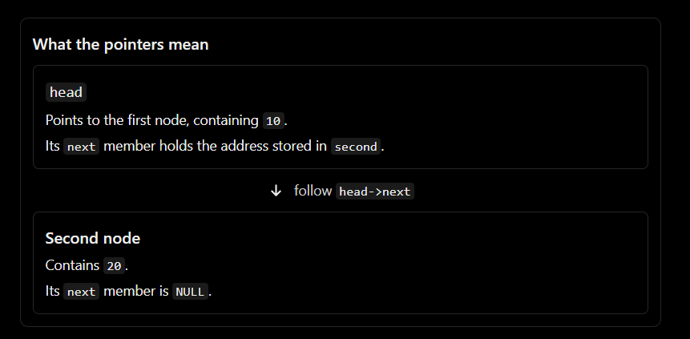

  
    An ordinary variable stores a value. A data structure gives us a way to organize related information. A dynamic data structure lets that organization grow or shrink while the program runs.

## The problem we trying to solve
Imagine that you are writing an application that tracks aircraft flying over a particular region. For every aircraft, you need to store:

- Its flight ID, such as ZA123
- Its altitude
- Its latitude and longitude
- Its heading
- Its airspeed

One aircraft is not represented by one simple number. It is a collection of different kinds of information that all describe the same real-world object. The textbook uses this aircraft-tracking example to introduce structures and then develops it into a dynamic linked list.

### Why not use separate variables?
We could write:
```
char flightID[7];
int altitude;
int longitude;
int latitude;
int heading;
double airSpeed;
```

This works for one aircraft. But what happens when we need to track 100 aircraft?

We might create separate arrays:
```
char flightIDs[100][7];
int altitudes[100];
int longitudes[100];
int latitudes[100];
int headings[100];
double airSpeeds[100];
```

Now we must remember that flightIDs[5], altitudes[5], latitudes[5], and airSpeeds[5] all describe the same aircraft.

That is possible, but the program becomes harder to understand and maintain.
Accidently using index 5 for one property and index 6 for another could mix up two aircraft.

The first lesson: when several values belong together conceptually, it is useful to group them together in one data object.

C provides a mechanism for doing exactly that: the struct.


## Structures in C: creating your own data type

### What is a struct?
Think of a structure as a form with several labeled fields.

An employee form might have a name, an ID, a salary, and a department. An aircraft form might have a flight ID, altitude, and airspeed.

A C structure lets us define that form once and then create as many individual objects of that form as we need.

Here is the textbook's aircraft structure, simplified slightly for learning:

```
struct Flight {
    char ID[7];
    int altitude;
    int longitude;
    int latitude;
    int heading;
    double airSpeed;
};
```

Let's understand every part
- struct tells C that we are declaring a structure type.
- Flight is the structure's tag, which identifies the type.
- char ID[7] is an array capable of holding up to six characters plus the terminationg '\0' character.
- The int members hold interger-valued properties.
- double airspeed holds the airspeed value.
- the semicolon after the closing brace is required.

Notice that we have described a type, not yet created an actual aircraft variable.


### Type description versus actual object
compare these two lines:
```
struct Flight {
    int altitude;
    double airSpeed;
};

struct Flight plane;
```

The first tells the compiler what a struct Flight contains.

the second creates a real variable called plane that has that structure type.

A useful analogy is a blueprint and a building:
- the structure declaration is the blueprint.
- plane is an actual object created using blueprint.

The blueprint itself is not the aircraft data. The variable is where the actual member values are stored.

### Accessing structure members with .
Once we have a structure variable, we access an individual member using the dot operator.

```
struct Flight plane;

plane.altitude = 10000;
plane.airSpeed = 800.0;
```

Read the first assignment as:

    Access the altitude member belonging to the structure variable plane, then store 10000 in that member.

The dot does not mean multiplication, and it does not access a separate global variable. it selects a field inside a particular structure object.

For example:
```
struct Flight plane1;
struct Flight plane2;

plane1.altitude = 10000;
plane2.altitude = 12000;
```

Both objects have a member called altitude, but they store separate values


### How does a structure occupy memory?
A structure's members occupy a region of memory allocated for that structure object. The compiler knows the member layout and generates instructions to access the appropriate member.

Conceptually, the memory could look like this:


This is a conceptual diagram, not a guarantee of exact byte offsets. Real C implementations may insert padding bytes between members to satisfy alignment requirements. Therefore, do not assume a structure's size is always the simple sum of the sizes you expect.

To find the actual size on the system compiling your program, use:
```
printf("%zu\n", sizeof(struct Flight));
```

The sizeof operator returns the size in bytes of the type or object on that implementation. The textbook highlights this portability issue when discussing memory allocation.

### typedef: giving a type a shorter name
you may have seen this:
```
typedef struct Flight Flight;
```

The purpose of typedef is to create a type alias. it does not create a new object or change the underlying structure layout.

After that declaration, you can write:
```
Flight plane;
```

instead of:
```
struct Flight plane;
```

The textbook uses this technique to make its aircraft type easier to use throughout the program.

here is the complete example:
```
#include <stdio.h>

typedef struct {
    int id;
    double salary;
} Employee;

int main(void)
{
    Employee worker;

    worker.id = 101;
    worker.salary = 45000.0;

    printf("ID: %d\n", worker.id);
    printf("Salary: %.2f\n", worker.salary);

    return 0;
}
```
employee is now the type name we use to declare employee objects.

Checkpoints: a struct groups different members into one object; . selects a member; typedef gives a type a convenient alias.


## Arrays of structures: storing many objects
Now we can represent one aircraft neatly. But our application needs to track many aircraft.
C allows us to create an array whose elements are entire structures:
```
Flight planes[100];
```

This declares an array of 100 Flight objects.

The important difference from our earlier separate arrays is that each array element contains all the fields belonging to one aircraft.



you can access a member of a particular element by combining the array index and dot operator:
```
planes[0].altitude = 10000;
planes[1].altitude = 12000;
```

Read planes[1].altitude as:

1. Select array element 1.
2. Within that structures, select its altitude member.

### The design problem with fixed-size arrays
Suppose the application is tracking aircraft, but you do not know how many will be in the region at a given time.

if you declare:
```
Flight planes[100];
```
you have space for 100 elements. What if there are 130 aircraft? Your declared array does not magically grow to accommodate them.

What if there are only three? The fixed capacity may be wasteful, depending on how the storage is allocated and used.

There is another issue: deleting an element from the middle of an array while keeping the remaining elements packed together requires moving subsequent elements. Inserting an element in the middle can require similar movement.

## Dynamic memory allocation: asking for memory while the program runs

### Stack memory versus heap memory



The key distinction is not that heap memory is automatically better. it is that the programmer controls when dynamically allocated storage is requested and released. The textbook explains that this enables objects to persist across multiple function calls and across longer portions of program execution.

### What does malloc actually do?
malloc is a C standard library function declared in <stdlib.h>.

You ask it for a number of bytes:
```
malloc(number_of_bytes);
```

Conceptually, the allocator:
1. Receives the requested size.
2. Looks for a suitable block in the heap.
3. Reserves that block if allocation succeeds.
4. Returns a pointer to the block's beginning.
5. Returns NULL if the allocation fails.

That pointer is how your program finds the allocated memory. You do not need to know the physical address in advance.

```
#include <stdio.h>
#include <stdlib.h>

int main(void)
{
    int *number = malloc(sizeof *number);

    if (number == NULL) {
        printf("Memory allocation failed.\n");
        return 1;
    }

    *number = 42;

    printf("%d\n", *number);

    free(number);
    number = NULL;

    return 0;
}
```

#### Step 1 — Declare a pointer and request memory
```
int *number = malloc(sizeof *number);
```

sizeof *number calculates the size of the object that number points to, which is an int. This is a convenient way to request the correct amount of memory without hardcoding a byte count.

malloc returns a pointer to the allocated block, or NULL if it cannot satisfy the request.

#### Step 2 — Check the result
```
if (number == NULL) {
    printf("Memory allocation failed.\n");
    return 1;
}
```

Never assume a memory request must succeed. If malloc returns NULL, you must not dereference that pointer.


#### Step 3 — Store a value in the allocated object
```
*number = 42;
```

Remember your earlier pointer lesson:
- number holds an address.
- *number accesses the int object at that address.

The allocated memory now stores 42.

#### Step 4 — Release the memory
```
free(number);
```

This tells the allocator that the block is no longer needed and can be reused. It does not mean the block is erased or that every pointer to it automatically becomes safe.

After free(number), using *number to access that released object is undefined behavior.


#### Step 5 — Clear the pointer
```
number = NULL;
```

This is a useful habit for a pointer variable that is no longer supposed to point to that object. It prevents this particular variable from retaining the old address. It does not clear any other copies of the pointer.

### Why use sizeof instead of hardcoded sizes?
Consider an array of n integers. The amount of memory required is:
```
n * sizeof(int)
```

For a dynamically allocated array of structures, the corresponding pattern is:
```
Flight *planes = malloc(n * sizeof *planes);
```

This expression requests enough bytes for n objects of the type pointed to by planes. It adapts to the actual type size on the target system.

For real production code, also check that the multiplication cannot overflow if n comes from untrusted or unrestricted input.


### The four memory mistakes you must recognize



These are not minor syntax errors. They are errors in the relationship between pointers, objects, and memory lifetime.


## Linked lists
We now have the ingredients:
- A struct can group the information belonging to one aircraft.
- A pointer can hold the address of an object.
- malloc can create an object whose memory is requested while the program is running.
- free can release that allocation.

The next step is to connect several such objects together.
That is the core idea behind a linked list.

### Why not simply keep using an array?
An array is a collection of elements stored contiguously. That makes indexed access convenient:
```
planes[0]
planes[1]
planes[2]
```

If you know the index, you can access the corresponding element directly.

A linked list takes a different approach. Each element, called a node, contains:
1. The data for that element.
2. A pointer that tells us where to find the next element.

The nodes do not have to sit next to each other in memory. The pointers connect them logically.

imagine that the aircraft are stored at unrelated locations:



The first node is called the head of the list. if we know where the head is, we can follow the pointers to reach every later node.

The last node uses NULL to indicate that there is no next node.

That gives us a rule:

    To move through a linked list, start at the head and follow the next pointer until it is NULL.

### Defining a linked-list node in C
```
typedef struct Node Node;

struct Node {
    int data;
    Node *next;
};
```

Let's unpack the unusual-looking part:
```
Node *next;
```

it means next is a pointer to another Node.

So each node contains an integer and an address that can lead to another node.

You might ask: how can a structure contain a pointer to its own type when that type is still being declared?

Because the member is a pointer, not a complete Node object nested inside itself. A pointer has a fixed size on a given implementation, so the compiler can represent the member without needing to place an entire second node inside the first.

if we instead tried to define a structure that directly contained a complete instance of itself, it would require more storage without end. A pointer avoids that problem.


### Building a linked list with malloc
Let's create a single node:
```
#include <stdio.h>
#include <stdlib.h>

typedef struct Node Node;

struct Node {
    int data;
    Node *next;
};

int main(void)
{
    Node *head = malloc(sizeof *head);

    if (head == NULL) {
        return 1;
    }

    head->data = 10;
    head->next = NULL;

    printf("%d\n", head->data);

    free(head);
    head = NULL;

    return 0;
}
```

There are two pointer-related expressions worth examining.

First:
```
head->data = 10;
```
The -> operator accesses a member through a pointer to a structure.

it is equivalent to:
```
(*head).data = 10;
```

why? Because *head means "the structure object pointed to by head," and .data selects that object's data member.

in other words:
- Use . when you have a structure object.
- Use -> when you have a pointer to a structure object.

Compare:
```
Node localNode;
Node *nodePointer = &localNode;

localNode.data = 10;
nodePointer->data = 20;
```

Both expressions access a structure member, but through different forms of refernce.

Second:
```
head->next = NULL;
```

This explicitly says the node has no successor yet. It is a one-node linked list, and that node is also the last node.

### Connecting two nodes
Now let's make two nodes.
```
Node *head = malloc(sizeof *head);
Node *second = malloc(sizeof *second);
```

In a real program, you must check both allocations before dereferencing either pointer. For clarity, imagine both allocations succeeded.
```
head->data = 10;
head->next = second;

second->data = 20;
second->next = NULL;
```

The first node stores the address of the second node in head->next.



The two nodes form a list because one node points to the other.

Notice what we did not do: we did not place the second node physically inside the first node. Each is a separate allocated object, and the first merely stores the address needed to reach the second.

This distinction between data and the pointer that connects the data is the mental model to retain.